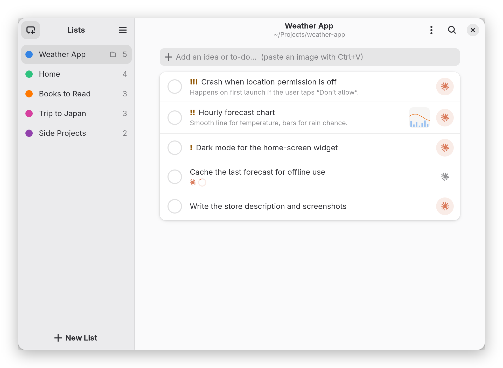

<div align="center">


# Ideas

**A to-do list for GNOME that hands your tasks to Claude Code.**

Jot down ideas and to-dos, attach screenshots, link a list to a project folder, and send any task
to [Claude Code](https://claude.com/claude-code) with one click. It's ticked off when Claude is done.

[](LICENSE)


[](https://github.com/voidrlm/ideas/releases)

[Install](#install) · [Features](#features) · [Claude Code](#send-to-claude-code) · [Email](#tasks-from-gmail-and-outlook) · [Keyboard](#keyboard-and-command-line) · [FAQ](#faq)

<picture>
  <source media="(prefers-color-scheme: dark)" srcset="screenshots/ideas-dark.png">
  
</picture>

</div>

## Install

Paste this into a terminal:

```sh
curl -fsSL https://raw.githubusercontent.com/voidrlm/ideas/main/install.sh | bash
```

That's it. Ideas appears in your app grid. The installer:

- installs the few system packages it needs (it asks for your password once),
- puts the app in `~/.local/opt/ideas` and adds a launcher. Nothing is installed system-wide,
- can be run again at any time to update to the latest release.

**Runs on:** Fedora 43+, Ubuntu 25.10+, Arch Linux and other distributions with libadwaita 1.8 or newer.

<details>
<summary>Other ways to install</summary>

**From a clone** (handy if you want to hack on it — the app runs straight from the folder):

```sh
git clone https://github.com/voidrlm/ideas.git
cd ideas && ./install.sh
```

**By hand:** install Python 3, PyGObject, GTK 4 and libadwaita ≥ 1.8, then run `./ideas`.

| Distribution | Packages |
|---|---|
| Fedora | `sudo dnf install python3-gobject gtk4 libadwaita git` |
| Ubuntu / Debian | `sudo apt install python3-gi gir1.2-gtk-4.0 gir1.2-adw-1 git` |
| Arch | `sudo pacman -S python-gobject gtk4 libadwaita git` |

</details>

## Features

- **Lists with colours.** Tick to-dos off; show or clear completed ones per list; search everything.
- **Fast capture.** Type and press <kbd>Enter</kbd>. `!`, `!!` or `!!!` set the priority, and `#ListName` files the to-do in another list.
- **Notes and images.** Paste screenshots with <kbd>Ctrl</kbd>+<kbd>V</kbd>, drag and drop images, or add them from a folder.
- **Send to Claude Code, Codex or OpenRouter.** Link a list to a project folder and every to-do gets a button for each coding agent you have. [More below](#send-to-claude-code).
- **Commit and push.** A list whose folder has uncommitted work shows a push button. It commits with a generated message and pushes, even across several repositories in one folder.
- **Tasks from Microsoft Teams** (optional). Pulls the things people asked you to do in unread Teams chats into a list, without marking anything as read. [More below](#tasks-from-microsoft-teams).
- **Tasks from Gmail and Outlook** (optional). The same for your unread email. [More below](#tasks-from-gmail-and-outlook).
- **Undo** for deletes and completions, and a full set of keyboard shortcuts.
- **Private.** Everything is kept in one JSON file on your computer. No account, no cloud, no tracking.

## Send to Claude Code

1. Open a list's menu → **Edit List…** and pick a project folder.
2. Each to-do in that list now has a round Claude button. Click it and a terminal opens in the
   folder with `claude` already working on the to-do: its title, notes and any attached images.
3. While Claude works, the to-do shows a spinner. When Claude finishes its reply, the to-do is
   ticked off, with **Undo** in case you want another round.

### Codex and OpenRouter

Ideas shows a button for every agent it finds, next to the Claude one:

| Button | Shown when | Runs |
|---|---|---|
| **Claude Code** | the `claude` command is installed | `claude` |
| **Codex** | the `codex` command is installed | `codex`, with the to-do's images attached |
| **OpenRouter** | `claude` is installed and `OPENROUTER_API_KEY` is set (in your environment or `~/.profile`) | Claude Code using OpenRouter as its model provider |

All of them work the same way: a terminal opens in the folder, a spinner shows while the agent works,
and the to-do is ticked off when it finishes its reply. To pick the OpenRouter model, set
`IDEAS_OPENROUTER_MODEL`, for example `export IDEAS_OPENROUTER_MODEL=openai/gpt-5` in `~/.profile`;
otherwise OpenRouter's default for Claude Code is used. Your OpenRouter key is read in the terminal and never put on a command line.

Use the list menu to send all open to-dos at once. If you close Claude Code before it finishes, the
to-do simply stays open. Sessions that finish while Ideas is closed are picked up the next time it opens.

This needs the [`claude`](https://claude.com/claude-code) command and a terminal: Ptyxis, GNOME Terminal,
Console, kitty, foot, WezTerm, Alacritty, Konsole or xterm.

## Commit and push

When a list's folder has uncommitted (or unpushed) work, a push button appears in the sidebar. It shows
what changed, then commits everything with a message written by the bundled
[`smart-commit`](smart-commit) script, in the repository's own commit style, and runs `git push`. A folder
holding several repositories, say a backend and a frontend, is handled in one go. If a push fails, the
commit is kept and the button pushes it next time.

`smart-commit` works on its own from a terminal too: `./smart-commit --help`.

## Tasks from Microsoft Teams

Press the button at the top of the sidebar (<kbd>Ctrl</kbd>+<kbd>T</kbd>). Ideas reads your **unread**
Teams chats and adds the things you've been asked to do to a **Teams** list, with who asked and the
original message in the notes.

- **Nothing changes in Teams.** Chats stay unread. Ideas reads them with plain GET requests and keeps its own note of how far it has looked.
- **No Azure app or admin consent needed.** A private Chromium (Playwright) signs in to Teams on the web once, in a window, and then runs unseen. It is set up automatically in `~/.local/share/ideas/teams-venv`.
- **Claude Code decides what counts as a task.** New messages are passed to `claude -p` with no tools allowed. This uses your own Claude Code sign-in.

## Tasks from Gmail and Outlook

Choose **Check Gmail for Tasks** (<kbd>Ctrl</kbd>+<kbd>G</kbd>) or **Check Outlook for Tasks** (<kbd>Ctrl</kbd>+<kbd>O</kbd>)
from the main menu. Ideas reads the **unread** mail in your inbox from the last 30 days and adds what
you've been asked to do to a **Gmail** or **Outlook** list, with the sender, subject and email in the
notes. **Open in Gmail / Outlook** in a to-do takes you to the email.

- **Nothing changes in your mailbox.** Email stays unread. Over IMAP the inbox is opened read-only; with Outlook on the web only GET requests are made. Ideas keeps its own note of which emails it has looked at.
- **Newsletters are skipped.** Mail with an unsubscribe header is never sent to Claude, and in Gmail the Promotions, Social and Forums tabs are left out.
- **Claude Code decides what counts as a task**, as for Teams: new emails go to `claude -p` with no tools allowed.

**Gmail** uses the Google account in **GNOME Settings → Online Accounts** (with *Mail* switched on).
No password or Google Cloud project is needed; if the account isn't there, Ideas offers to open Online Accounts.

**Outlook** uses a Microsoft or Microsoft 365 account from Online Accounts if you have one. Otherwise,
choose **Sign In to Outlook…** once: like Teams, a private Chromium signs in to Outlook on the web and
then runs unseen, so it works for work accounts without an Azure app or admin consent.

## Keyboard and command line

Press <kbd>Ctrl</kbd>+<kbd>?</kbd> in the app for every shortcut.

```sh
ideas                                 # open the window
ideas --add "Try a dark theme !!"     # add a to-do without opening the window
ideas --new                           # open with the add box focused
```

Tip: bind `ideas --new` to a keyboard shortcut in GNOME Settings to capture an idea from anywhere.

## FAQ

**Where is my data?**
In `~/.local/share/ideas/data.json`, saved after every change, with attached images in `images/` next
to it. Back up that folder to keep everything. Set `IDEAS_DATA=/path/to/file.json` to use another file.

**Do I need Claude Code?**
No. Ideas is a complete to-do app on its own. The Claude button only appears on lists you link to a folder.

**Does it have due dates or notifications?**
No, on purpose. Ideas is for capturing and working through ideas, not for nagging you.

**How do I uninstall it?**

```sh
curl -fsSL https://raw.githubusercontent.com/voidrlm/ideas/main/install.sh | bash -s -- --uninstall
```

Your lists are kept in `~/.local/share/ideas` unless you delete that folder.

## Contributing

Bug reports and pull requests are welcome. Ideas is plain Python with no build step:
`ideas_core.py` holds the data model (no GTK), `ideas.py` the interface, `ideas_git.py` the
commit-and-push feature, `ideas_teams.py` the Teams reader and `ideas_mail.py` the Gmail and Outlook reader. Run `./ideas` from a clone to try your changes.

If Ideas is useful to you, please ⭐ **star the repo**. It helps other people find it.

## License

[MIT](LICENSE)
